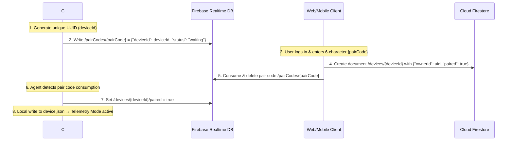
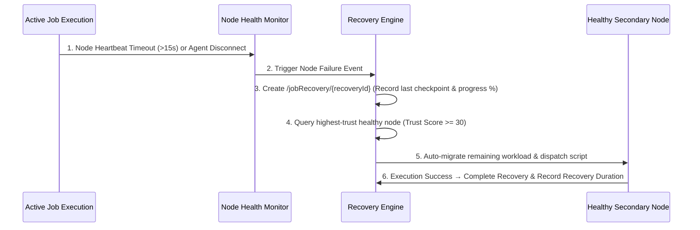
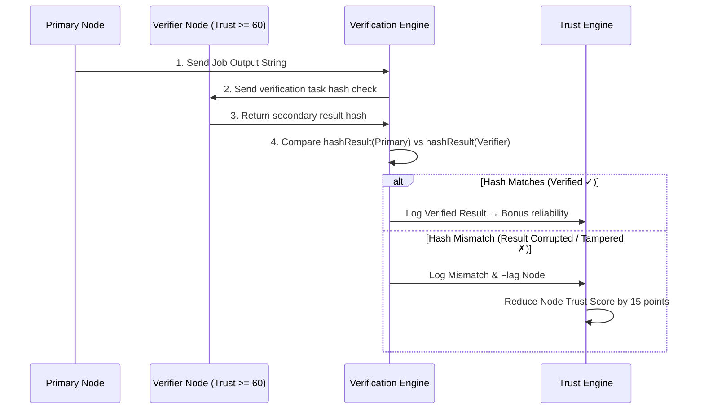

# ClusterOS — Distributed AI Computing & Intelligent Workload Platform

<div align="center">

[](https://nextjs.org)
[](https://typescriptlang.org)
[](https://firebase.google.com)
[](https://dotnet.microsoft.com)
[](https://kotlinlang.org)
[](https://developer.android.com/compose)
[](LICENSE)

**Production-grade distributed computing platform featuring real-time hardware telemetry, AI-driven workload scheduling, dynamic node trust scoring, automated job drop recovery, result verification, and compute rental hosting.**

</div>

---

## 📖 Table of Contents
1. [System Architecture & Full Pipeline](#-system-architecture--full-pipeline)
   - [Full End-to-End System Pipeline](#1-full-end-to-end-system-pipeline)
   - [Zero-Configuration Pairing Handshake](#2-zero-configuration-pairing-handshake)
   - [Telemetry & Process Streaming Pipeline](#3-telemetry--process-streaming-pipeline)
   - [Node Trust & Intelligent Scheduling Engine](#4-node-trust--intelligent-scheduling-engine)
   - [Job Drop Recovery & Fault Tolerance Pipeline](#5-job-drop-recovery--fault-tolerance-pipeline)
   - [Result Verification & Anti-Spoofing Pipeline](#6-result-verification--anti-spoofing-pipeline)
2. [Project Folder & File Structure](#-project-folder--file-structure)
3. [Database Architecture & Collections](#-database-architecture--collections)
4. [Hackathon Challenge Module: Node Trust & Job Recovery](#-hackathon-challenge-module-node-trust--job-recovery)
5. [Installation & Local Setup](#-installation--local-setup)
   - [Prerequisites](#prerequisites)
   - [1. Web Dashboard (Next.js)](#1-web-dashboard-nextjs)
   - [2. Windows C# Desktop Agent](#2-windows-c-desktop-agent)
   - [3. Android Kotlin Mobile Agent](#3-android-kotlin-mobile-agent)
6. [Verification & Building](#-verification--building)

---

## ⚙️ System Architecture & Full Pipeline

### 1. Full End-to-End System Pipeline

```mermaid
flowchart TD
    subgraph Nodes["🖥️ Cluster Nodes (Heterogeneous PCs / Mobiles)"]
        W_Agent["Windows C# Agent (LibreHardwareMonitor)"]
        R_Agent["Windows C# Rental Agent"]
        M_Agent["Android Kotlin Mobile Agent"]
    end

    subgraph Firebase["🔥 Cloud Infrastructure"]
        RTDB["Firebase Realtime Database (Live Telemetry & Logs)"]
        Firestore["Cloud Firestore (Devices, Jobs, Trust, Recovery, Verification)"]
    end

    subgraph Engine["🧠 ClusterOS Core Engine (Dashboard)"]
        TrustEngine["Dynamic Node Trust Engine (0-100)"]
        Scheduler["Intelligent AI Workload Scheduler"]
        RecoveryEngine["Job Drop Recovery Manager"]
        VerifyEngine["Result Verification & Integrity Checker"]
    end

    subgraph UI["💻 Command Center (Next.js Dashboard)"]
        DashUI["Command Center Dashboard"]
        TrustUI["Trust & Recovery Portal"]
        AnalyticsUI["Analytics & Historical Insights"]
        StudioUI["Workload & Notebook Studio"]
    end

    Nodes -->|Every 5s Hardware Metrics| RTDB
    Nodes -->|Device Identity & Pair Handshake| Firestore
    
    RTDB -->|Real-time Socket Stream| TrustEngine
    Firestore -->|Node History & Disconnection Events| TrustEngine
    
    TrustEngine -->|Dynamic Trust Scores| Scheduler
    StudioUI -->|Submit Job / Python Code| Scheduler
    
    Scheduler -->|Optimal Node Routing| Nodes
    Nodes -->|Job Execution Output| RTDB
    
    Nodes -->|Node Disconnection / Failure| RecoveryEngine
    RecoveryEngine -->|Save Checkpoint & Auto-Migrate| Nodes
    
    Nodes -->|Job Output Hashes| VerifyEngine
    VerifyEngine -->|Cross-Check Hashes| Firestore
    VerifyEngine -->|Flag Unreliable Node (-15 pts)| TrustEngine

    TrustEngine --> TrustUI
    RecoveryEngine --> TrustUI
    VerifyEngine --> AnalyticsUI
    RTDB --> DashUI
```

---

### 2. Zero-Configuration Pairing Handshake

A secure, passwordless handshake matches physical nodes to dashboard users.



---

### 3. Telemetry & Process Streaming Pipeline

Every **5 seconds**, agents scrape system telemetry and stream metrics to Firebase:
- **Hardware Metrics**: CPU Load/Temperatures, RAM Usage, GPU Load/VRAM, Disk speeds, and Ping Latency.
- **Top Processes**: Collects active processes, sorts by CPU/RAM usage, and uploads top 20 heavy entries to `/devices/{deviceId}/processes`.
- **Live Sockets**: Dashboard components subscribe via Firebase Realtime sockets for zero-latency UI updates without HTTP polling.

---

### 4. Node Trust & Intelligent Scheduling Engine

The **Intelligent Scheduler** ranks all candidate nodes using a weighted multi-criteria scoring algorithm:

$$\text{Final Score} = w_{\text{cpu}} \cdot S_{\text{cpu}} + w_{\text{ram}} \cdot S_{\text{ram}} + w_{\text{gpu}} \cdot S_{\text{gpu}} + w_{\text{temp}} \cdot S_{\text{temp}} + w_{\text{net}} \cdot S_{\text{net}} + w_{\text{queue}} \cdot S_{\text{queue}} + w_{\text{rel}} \cdot S_{\text{rel}} + w_{\text{disk}} \cdot S_{\text{disk}} + w_{\text{trust}} \cdot S_{\text{trust}}$$

$$\text{Trust Score} = 0.25 \cdot \text{Uptime} + 0.25 \cdot \text{CompletionRatio} + 0.20 \cdot \text{Heartbeat} + 0.15 \cdot \text{ResponseTime} + 0.10 \cdot \text{Health} - \text{Penalties}$$

Nodes with **Trust Score < 30** are automatically excluded from job recovery assignments.

---

### 5. Job Drop Recovery & Fault Tolerance Pipeline



---

### 6. Result Verification & Anti-Spoofing Pipeline



---

## 📁 Project Folder & File Structure

```
cluster_sheduling_AI/
├── agent/
│   ├── ClusterOSAgent/                 # Windows C# Desktop Agent (.NET 9)
│   │   ├── AgentConfig.cs             # Local configuration model
│   │   ├── AgentService.cs            # Core telemetry & command polling loop
│   │   ├── DevicePairingService.cs    # Pair code handshake implementation
│   │   ├── MainForm.cs                # System tray & GUI monitor window
│   │   ├── Commands/                  # Script & process execution handlers
│   │   ├── Firebase/                  # Realtime DB & Firestore REST connectors
│   │   └── Hardware/                  # LibreHardwareMonitor hardware scraper
│   ├── ClusterOSRentalAgent/           # Windows Host Rental Agent variant
│   └── installer/                      # Windows Service setup binaries
│
├── dashboard/                          # Web Application (Next.js 16 App Router)
│   ├── src/
│   │   ├── app/
│   │   │   ├── (auth)/login/          # User authentication portal
│   │   │   └── (dashboard)/
│   │   │       ├── page.tsx           # Command Center (KPIs & Trust Widgets)
│   │   │       ├── trust/             # Node Trust & Job Recovery Portal
│   │   │       ├── analytics/         # Trust History & Verification Analytics
│   │   │       ├── jobs/              # Workload Studio & Execution Engine
│   │   │       ├── notebook/          # AI Training Studio
│   │   │       ├── devices/           # Device Inventory & Pairing
│   │   │       ├── clusters/          # Cluster Management
│   │   │       ├── processes/         # Remote Process Manager
│   │   │       ├── commands/          # Remote Command Terminal
│   │   │       ├── rentals/           # P2P Compute Rental Marketplace
│   │   │       └── settings/          # User Profile & Scheduler Weights
│   │   ├── components/
│   │   │   ├── NodeTrustDetailPanel.tsx # Sub-score breakdown & score gauge
│   │   │   ├── SchedulerWeightsPanel.tsx# Custom scoring weight sliders
│   │   │   ├── AiReportModal.tsx       # AI Scheduler explanation modal
│   │   │   ├── layout/                 # Dashboard navigation layout
│   │   │   └── charts/                 # Metric gauges & Recharts components
│   │   ├── lib/
│   │   │   ├── trust.ts               # Dynamic Node Trust Score calculation
│   │   │   ├── recovery.ts            # Job Drop Recovery engine
│   │   │   ├── verification.ts        # Result Verification & Hashing engine
│   │   │   ├── trustHistory.ts        # Time-series trust history persistence
│   │   │   ├── scheduler.ts           # Multi-criteria Intelligent Scheduler
│   │   │   ├── db.ts                  # Firestore database operations
│   │   │   ├── rtdb.ts                # Realtime Database sockets & streaming
│   │   │   └── firebase.ts            # Client Firebase SDK initialization
│   │   ├── store/
│   │   │   └── appStore.ts            # Global Zustand state store
│   │   └── types/
│   │       └── index.ts               # Core TypeScript interfaces & schemas
│   ├── package.json
│   └── tsconfig.json
│
├── mobile-agent/                       # Native Android Agent (Kotlin 2.0)
│   └── app/src/main/java/com/clusteros/agent/
│       ├── MainActivity.kt            # Android UI & pair code entry
│       ├── TelemetryService.kt        # Android hardware scraper background service
│       └── FirebaseClient.kt          # OkHttp Firebase REST client
│
├── firebase.json                       # Firebase deployment configuration
├── .firebaserc                         # Firebase project aliases
└── README.md                           # Project documentation
```

---

## 🗄️ Database Architecture & Collections

### Firestore Collections (`db`)
- `devices`: Physical node identity, ownership (`ownerId`), pairing status, and last seen timestamp.
- `clusters`: User-created node groupings and cluster membership.
- `jobs`: Workload definitions, python scripts, scheduling decisions, and status lifecycle.
- `commands`: Remote shell commands dispatched to individual nodes.
- `trustScores`: Dynamic Trust Scores (0-100), sub-scores, verification metrics, and flagged status keyed by `deviceId`.
- `jobRecovery`: Active and historical job recovery records tracking migration events and durations.
- `verificationLogs`: Output hash comparisons, primary vs verifier node IDs, and match statuses.
- `trustHistory`: Time-series snapshot log of trust scores taken every 30 seconds for analytics.

### Realtime Database Nodes (`rtdb`)
- `/pairCodes/{pairCode}`: Ephemeral 6-character pairing handshake keys.
- `/devices/{deviceId}/metrics`: Live 5s hardware telemetry snapshot.
- `/devices/{deviceId}/processes`: Top 20 active processes sorted by resource consumption.
- `/jobOutput/{commandId}`: Live stdout/stderr terminal execution logs streamed line-by-line.
- `/commandResults/{commandId}`: Final execution status and return code.

---

## 🛡️ Hackathon Challenge Module: Node Trust & Job Recovery

This module extends ClusterOS with enterprise-grade fault tolerance:

| Requirement | Implementation Summary | Key File |
| :--- | :--- | :--- |
| **Dynamic Trust Score (0-100)** | Real-time score combining uptime, completion ratio, heartbeat stability, ping latency, and health status with disconnection penalties. | [`src/lib/trust.ts`](file:///d:/Cluster/cluster_sheduling_AI/dashboard/src/lib/trust.ts) |
| **Scheduler Enhancement** | Integrated Trust Score (10% weight) into the Intelligent Scheduler scoring formula. Excludes nodes < 30 score from recovery. | [`src/lib/scheduler.ts`](file:///d:/Cluster/cluster_sheduling_AI/dashboard/src/lib/scheduler.ts) |
| **Job Drop Recovery** | Detects node failure, saves last checkpoint, selects healthiest secondary node, and migrates remaining workload. | [`src/lib/recovery.ts`](file:///d:/Cluster/cluster_sheduling_AI/dashboard/src/lib/recovery.ts) |
| **Result Verification** | Cross-checks job output hashes between primary node and verifier node. Mismatches deduct 15 trust points and flag the node. | [`src/lib/verification.ts`](file:///d:/Cluster/cluster_sheduling_AI/dashboard/src/lib/verification.ts) |
| **Dashboard Integration** | Live widgets for Node Trust Overview, Job Recovery Status, and Verification Status on Command Center (`/`). | [`src/app/(dashboard)/page.tsx`](file:///d:/Cluster/cluster_sheduling_AI/dashboard/src/app/(dashboard)/page.tsx) |
| **Analytics** | Time-series Trust History line chart, Recovery Logs, Verification Logs, and Failure History. | [`src/app/(dashboard)/analytics/page.tsx`](file:///d:/Cluster/cluster_sheduling_AI/dashboard/src/app/(dashboard)/analytics/page.tsx) |

---

## 🚀 Installation & Local Setup

### Prerequisites
- **Node.js**: v18.0.0 or higher
- **npm**: v9.0.0 or higher
- **.NET SDK**: v9.0 (for C# agent)
- **Android Studio**: Ladybug / Jellyfish (for Kotlin mobile agent)

---

### 1. Web Dashboard (Next.js)

```bash
# Navigate to dashboard directory
cd dashboard

# Install dependencies
npm install

# Run development server
npm run dev
```

Open [http://localhost:3000](http://localhost:3000) in your browser.

---

### 2. Windows C# Desktop Agent

```bash
# Navigate to C# Agent directory
cd agent/ClusterOSAgent

# Build and run the desktop agent GUI
dotnet run
```

---

### 3. Android Kotlin Mobile Agent

1. Open `mobile-agent/` in **Android Studio**.
2. Sync Gradle dependencies.
3. Deploy to an Android emulator or physical device running Android 8.0+ (API 26+).

---

### 4. AI Workload Studio & Execution Pipeline

The dashboard features a Monaco-powered cloud IDE tailored for distributed computing workloads:
- **Pre-configured Workload Templates**: Instant simulation presets including NumPy ML Model Training, Matrix Multiplication Benchmarks, Distributed Data Pipelines, and System Stress Tests.
- **Dedicated & Cluster Routing**: Smart automatic routing via composite node scoring or manual assignment to dedicated online PCs.
- **Interactive Workload Controls**: Real-time console streaming with options to clear terminal buffers, stop running workloads midway, and re-run historical jobs with one click.
- **Automated Drop Recovery & Verification**: Fault tolerance powered by heartbeat monitoring with automatic node redispatch and synthetic anti-spoofing verification.

---

## 🧪 Verification & Building

To perform a complete typecheck and production build of the web dashboard:

```bash
cd dashboard
npm run build
```

---

<div align="center">
Built for the Distributed Computing Hackathon · <b>ClusterOS Engine</b>
</div>
